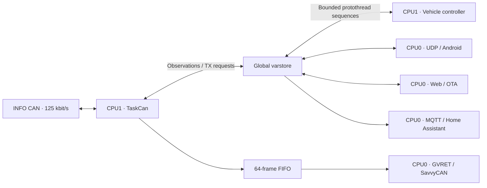

# eCMPilot Gateway

**ESP32 firmware connecting an Opel Corsa-e's INFO CAN bus to the eCMPilot Android app and Home Assistant.**

The development hardware is the **[Waveshare ESP32-S3-RS485-CAN](https://www.waveshare.com/wiki/ESP32-S3-RS485-CAN)**: one CAN channel, RS485 and onboard power conversion. The installed prototype listens to **ENT INFO CAN at 125 kbit/s** near the BSI, using the black **IC91B** interconnection. Permanent power is taken from the adjacent yellow **IC95A** connector in the owner's installation.

**Current firmware: 0.5.0 · ESP-IDF 5.3.2 · ESP32-S3.** The companion Android repository is **`ecmpilot`**. This is an independent research/development project; support for other vehicles is not established.

## What the gateway provides

- **Vehicle telemetry:** SOC/range, outside temperature, odometer, vehicle/BSI state, 12 V battery voltage/SOC, charging and preconditioning reports, door/lock states, trips and consumption fields where available.
- **Explicit vehicle actions:** bounded wake/refresh, immediate/delayed charging, preconditioning Start/Stop and native weekly program editing. Opening the app and passive reads do not wake the vehicle.
- **Automatic refresh:** persistent standby/charging periods and a minimum 12 V SOC. Off by default; initial settings are **60 min / 5 min / 50%**.
- **Charge limit:** optional SOC target; requests delayed charging after an updated SOC reaches the limit. Requires automatic refresh, defaults off with an 80% target, and may resume at the vehicle's stored charging start time.
- **Android UDP:** direct local communication on **42840**, with correlated requests, duplicate suppression and command-result tracking.
- **Home Assistant:** optional MQTT Discovery with 47 observation/diagnostic entities and a Refresh vehicle button. Explicit HA refresh requests share the phone's controller and result tracking; broker settings are in the web UI. MQTT is disabled by default. See [HA commands](docs/home-assistant/commands.md).
- **SavvyCAN:** GVRET over **TCP 23**, one client, vehicle RX plus local TX submissions, using a static 64-frame diagnostic queue. SavvyCAN-to-vehicle TX is disabled.
- **Web tools:** Home, Varstore, Wi-Fi setup, OTA, Log, Tasks and Home Assistant configuration; runtime CPU/stack/heap diagnostics, reset reasons and a retained previous-boot log tail.
- **Low power:** automatic CAN-wake deep sleep after configurable vehicle inactivity (default 48 hours), plus manual CPU/power controls.

The implementation is working on the owner's car. Mappings have different confidence levels: source definitions, capture comparisons and owner checks are recorded separately. Trip/body fields and newly written preconditioning programs still need further physical validation.

## Hardware and vehicle connection

The current firmware pin mapping is **CAN TX GPIO15 / CAN RX GPIO16**. PSRAM is disabled; the build uses a conservative **4 MiB flash layout**. This is the RS485 + single-CAN board, not the Waveshare two-channel CAN kit or the LCD board.

**Optional low-power hardware modification:** the owner's prototype has a modified interface power supply with the isolated DC/DC converter removed to reduce its standing consumption. This modification is **not required to run the firmware**; the unmodified board retains the converter's power overhead. The modified prototype measured approximately **20 mA while running with dynamic CPU frequency** and **6 mA in deep sleep**, both at the **12 V board input**. See [the measured operating modes](#vehicle-sleep-and-power) and [component power budget](powe_consumption.md) for details; these figures do not describe the stock board.

| Connection | Installation reference |
| --- | --- |
| INFO CAN conductor `9034` | **IC91B pin 14**, black 22-way connector; dashboard side pink (`RS`), body side white (`BA`) |
| INFO CAN conductor `9035` | **IC91B pin 15**; dashboard side violet (`VI`), body side green (`VE`) |
| Permanent +12 V | **IC95A pin 16**, adjacent yellow 22-way connector, pink wire; owner-reported installation, factory feed/fuse route not established |
| Ground | A verified vehicle ground; no ground pin is established by the IC91B references |

See **[vehicle wiring and installation notes](docs/hardware/vehicle-wiring.md)** for connector identification, colour translations, evidence limits and the electrical-interface caveat. The table identifies the pair; it does not assign CAN H/L from wire numbers alone. `22V` in the French connector designation means **22 cavities**, not 22 volts.

The alternative **HSCAN1 / 500 kbit/s** profile is listen-only and exposes HV SOC/pack voltage from `0x5C3`. It is not the default installed INFO profile and cannot execute the INFO wake/control sequences. OBD **6/14** is a different connection from the INFO pair above.

Board references: [manufacturer schematic](https://files.waveshare.com/wiki/ESP32-S3-RS485-CAN/ESP32-S3-RS485-CAN-Schematic.pdf), [component power budget](powe_consumption.md).

## Architecture



All application observations and command requests cross **varstore**. CAN RX handlers only decode/publish; the separate controller reads state and sequences wake, command and confirmation with bounded retries/timeouts. TaskCan owns the hardware. Network code never calls the CAN driver directly.

Varstore supports int32 values, observation ages, validity and independent force overlays. A force changes consumer reads without overwriting producer data. The web browser shows 14 signals per page. Internal measurement units are mV, mA, m°C, W and tenths of a percent; UDP/MQTT convert to user units.

## Build and first flash

Use **ESP-IDF 5.3.2**, target **esp32s3**. The component manifest accepts the 5.3 series. From an activated IDF shell:

```sh
idf.py build
idf.py -p YOUR_SERIAL_PORT flash monitor
```

Windows helpers:

```powershell
.\dev.ps1 build
.\dev.ps1 size
.\dev.ps1 flash -Port COMx
.\dev.ps1 monitor -Port COMx
```

The helper discovers `C:\Espressif`; override `IDF_PATH` / `IDF_TOOLS_PATH` or pass its `-IdfPath` / `-ToolsPath` options. Select an explicit serial port. The default console uses native USB Serial/JTAG.

The first installation must flash the bootloader, partition table, OTA data and application. Subsequent web OTA uploads use **`build/ecmpilot_gw.bin`**. An application-only upload cannot replace an incompatible partition layout. Two application slots and bootloader rollback are enabled; recovery remains available over USB.

Choose bus profile/rate with `idf.py menuconfig` → **eCMPilot CAN receiver**. Tracked defaults select **INFO / 125 kbit/s / normal mode**. Keep the profile, bitrate and physical wiring consistent.

## Initial network setup

The setup AP is **disabled by default**. Provision the first Wi-Fi profile over the serial console:

```text
wifi add "Your WiFi" "your-password"
wifi hostname ecmpilot-gw
wifi list
status
```

Open the IP address printed by the gateway. The web **Wi-Fi setup** tab edits saved station profiles, hostname and the optional setup AP's enable flag/password. Settings persist in NVS. The usual router-DNS address is `ecmpilot-gw.lan`; availability of that name depends on the local router. Use the assigned IP when necessary.

| Service | Address / configuration |
| --- | --- |
| Web UI / OTA | `http://GATEWAY_IP/` |
| Android app | UDP **42840**, phone on a reachable local network |
| SavvyCAN | GVRET network connection, TCP **23**, one client |
| Home Assistant | Configure and enable the broker under web **Home Assistant**; default MQTT port **1883** |

HTTP and UDP are currently unauthenticated/unencrypted, OTA images are unsigned, and saved Wi-Fi/MQTT settings are not encrypted in NVS. Use a trusted local network and keep these services off the public internet. Same-origin browser checks and a learned gateway ID are not authentication.

## Vehicle sleep and power

INFO traffic can stop while AC charging continues. Reading the gateway cannot make old measurements current; it preserves the last values and their CAN observation ages. An explicit or enabled automatic refresh can wake BSI and request updated data. Repeated wake requests may be ignored by the vehicle.

The owner's modified board, with its isolated DC/DC module removed, measured approximately:

| Mode | Current at 12 V |
| --- | ---: |
| Fixed CPU 160 MHz | 22 mA |
| Dynamic frequency | 20 mA |
| Manual deep sleep, CAN RX wake armed | 6.3 mA |

These are whole-board measurements of that modified installation. The stock board has a higher power budget. The running TWAI driver blocks actual automatic light sleep. Deep sleep drops Wi-Fi/phone/HA access and restarts the ESP on wake; the owner confirmed CAN wake on the installed vehicle. Automatic entry is enabled by default after 48 hours without a valid BSI report; configure it and view the countdown under **Low power** on the web or **Gateway → Low power** in the phone. See [automatic sleep](docs/low-power.md).

See [vehicle sleep observations](doc/car_lowpower.md) and [power modes/test procedure](docs/power-management.md).

## Documentation

Start with the **[documentation index](docs/README.md)**. The consolidated
**[CAN request reference](docs/can-requests.md)** lists current wake, refresh,
charging and preconditioning frames, readbacks, timeouts and unresolved cloud behavior.

| Guide | Contents |
| --- | --- |
| [Vehicle wiring](docs/hardware/vehicle-wiring.md) | Waveshare, IC91B INFO pair and adjacent IC95A power reference |
| [CAN architecture](docs/can.md) / [RX mappings](docs/can-rx.md) | Task ownership, queues, fields and live RX |
| [INFO DBC](dbc/README-info.md) / [HSCAN1 DBC](dbc/README.md) | Signal databases, source licensing and validation scope |
| [Vehicle control](docs/vehicle-control.md) | Wake, refresh, charge sequencing and timeouts |
| [Preconditioning](docs/preconditioning.md) / [weekly programs](docs/preconditioning-programs.md) | Immediate and scheduled requests/readback |
| [Automatic refresh](docs/auto-refresh.md) / [Charge limit](docs/charge-limit.md) | Persistent gateway automation |
| [Android UDP](docs/udp.md) / [correlation](docs/udp-correlation.md) | Local protocol and loss/retry handling |
| [Home Assistant](docs/ha.md) | Broker setup, discovery, values and freshness |
| [SavvyCAN](docs/gvret.md) | GVRET setup and local TX observation limits |
| [Reset diagnostics](docs/reset-diagnostics.md) / [socket budget](docs/network-sockets.md) | Runtime diagnostics |
| [Testing](docs/testing.md) | Native/web tests and hardware checks |

Capture evidence is separated under [research](docs/research/README.md); superseded experiment diaries have been removed from the current guides. Original service-manual scans are not required to build the firmware and are not included in this repository.

## License and intended use

New project code is **[BSD-2-Clause](LICENSE)**. Imported runtime/protothreads retain BSD-3-Clause notices; PSA-RE-derived INFO definitions retain Apache-2.0 attribution. See **[THIRD_PARTY_NOTICES.md](THIRD_PARTY_NOTICES.md)** and the [DBC notices](dbc/README-info.md). ESP-IDF dependencies retain their own licenses; firmware binary redistribution also needs the applicable linked SDK notices.

Experimental software for research and interoperability with equipment you own or are authorised to test. **Not approved for use on public roads.** Vehicle installation and use require a separate electrical/vehicle assessment. Not affiliated with or endorsed by Opel, Stellantis or Waveshare. Provided without warranty under the applicable licenses.
