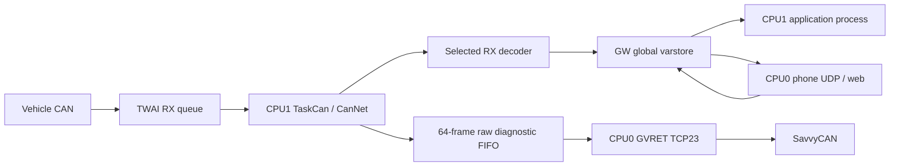

# CAN input and process-data architecture

Current configuration: **INFO, 125000 bit/s, normal mode**, Waveshare ESP32-S3-RS485-CAN,
**TX GPIO15 / RX GPIO16**, firmware version unchanged at 0.5.0. The GPIO wake-up
experiment has been removed, including its web/API controls and varstore signals.

## Process boundary

**All application data crosses the native GW varstore.** RX handlers acquire,
validate and publish observations; they never call a controller or execute an
action. The existing application process separately derives climate values and
requests configurable one-shot wake TX through varstore. TaskCan consumes those requests; UDP
never calls the CAN driver. See [current parity](lcd-backport.md).

Each signal has one producer. Force is an independent overlay, leaving live
producer values intact. Varstore holds current state; button events therefore
also have cumulative press counters. A controller must not consume the raw
last-frame diagnostic slot as an event queue. The SDK RX queue and GVRET FIFO
are internal transport, with the latter used only for diagnostics.

## TaskCan / CanNet

`main/task_can.cpp` follows the LCD TaskCan/CanNet structure using this project's
BSD runtime. No `components/ufrm` dependency or LCD GPIO mapping is imported.

| Worker/resource | Configuration |
| --- | --- |
| `CanTask` | CPU1, priority 5, static 4096-byte stack |
| `canAlert` | CPU1, priority 6, 3072-byte stack |
| TWAI installation/IRQ | CPU1, level 1, IRAM driver interrupt |
| `Tmr Svc` | CPU1, priority 24; callback only notifies the process |
| Physical mode | INFO normal (default); optional HSCAN1 listen-only; TX queue0, single-shot, accept all RX IDs |
| SDK RX queue | 128 frames |
| RX processing | At most 64 frames per notification; 10 ms timer fallback |
| Health publication | Every 500 ms |

The alert task waits on SDK notifications and signals TaskCan; it does not
decode frames or access sockets. TaskCan owns the TWAI v2 handle, driver state
changes, receive loop and decoder. Bus-off/recovery is serviced by that owner.
Initialization failure publishes a fault while web/UDP diagnostics remain usable.
IRAM interrupt support does not make finite RX queues lossless during CPU stalls.

Listen-only sends neither data frames nor ACK/error frames. A lone transmitting
bench adapter therefore needs another acknowledging receiver for normal traffic.
Hardware mapping: [Waveshare schematic](https://files.waveshare.com/wiki/ESP32-S3-RS485-CAN/ESP32-S3-RS485-CAN-Schematic.pdf).

`menuconfig → eCMPilot CAN receiver` selects the decoder profile and bitrate.
Defaults select **INFO/125 kbit/s** in both `sdkconfig.defaults` and the local
build. This enables the INFO RX handlers and [configurable wake frame](info-can-wake.md).
Version `0x5DF` TX has been removed completely. Optional HSCAN1/500 kbit/s
publishes HV SOC and pack voltage from `0x5C3`; see [HS1 mappings](can-telemetry.md).
INFO and HS1 mappings never run together. Wake TX is hard-disabled on HSCAN1,
including forced requests; that profile stays listen-only.

The hardware must use the correct physical interface for INFO CAN. Changing
bitrate alone does not turn the stock high-speed transceiver into the appropriate
fault-tolerant INFO interface; use the separately validated vehicle connection.

## Data and diagnostics

See [RX mappings and replay](can-rx.md) and [GVRET](gvret.md).
Filter Varstore for `can.`, `steering.` or `gvret.`. All producer-owned signals
permit Force/Release, with direct Write/Touch/Invalidate disabled.

`can.state`: 0 disabled, 1 initializing, 2 listening, 3 stopped, 4 bus-off,
5 recovering, 6 fault. `can.last_error` is the latest receiver error.
Health includes `can.heartbeat`, `can.rx.count`, `.rejected_count`, `.rtr_count`,
`.missed_count`, `.overrun_count`, `.error_counter`, `.pending`,
`can.bus_error_count`, `can.decode_count`, `can.decode_rejected_count` and
`can.demo_frame_count`. Raw RX counters wrap at 2^31; decoder/replay counters
saturate at INT32_MAX. Health descriptors use a 2-second default freshness limit.

`can.rx.last.id`, `.dlc`, `.extended`, `.data0` through `.data7` contain the last
structurally accepted data frame, zero-filled beyond DLC. RTR only increments a
counter. Last-frame fields begin invalid, expire after 5 seconds and are refreshed
only by a new data frame. `.generation` is odd during publication and even after.
An unforced coherent diagnostic read can compare even generations before/after
the fields; defer a failed group read rather than spinning at higher CPU1 priority.
Forces on individual fields can intentionally break group coherence.

Timestamps are software dequeue/publication times, including any preceding driver
queue delay. No traffic means ageing observations, never an invented asleep/zero
vehicle state. Health publication does not refresh decoded observations.

## Verification

`tests/run-udp.ps1 -PythonPath python` compiles both decoder profiles against the
real GW store/UDP code. INFO capture and pipeline tests cover replay/live switches,
units, validity, ownership and force preservation. GVRET tests exercise the actual
C worker through real loopback TCP. The physical TWAI driver is not host-simulated.

On a board, verify pins/rate, passive behaviour, decoded values against the car,
raw bytes against a second capture tool, both upstream RX and GVRET loss counters,
CPU affinity, heap/stack margins and sustained Wi-Fi operation. Use Tasks for heap
details. See [test procedures](testing.md) and [LCD comparison](lcd-backport.md).
